Choose one of two options to complete the hands-on exercises in this course:

## Compute Options

- **[Using AWS](#using-aws):** Launch a virtual computer (an *EC2 instance*) in the Amazon cloud, then connect to it from your computer.
- **[Using Docker](#using-docker):** Run a prebuilt course image locally on a computer with Docker installed.

## Using AWS

You will first launch an EC2 instance from the course's preconfigured Amazon Machine Image (AMI), then log in using SSH. For background on cloud computing and AWS terminology, see [Introduction to AWS](/module-00-setup/0000/04/01/Intro_to_AWS/).

### Launching an AWS instance

You will need an AWS account: your own, one provided by your institution, or an IAM user account assigned for a live course. The steps below use the live course account; the process is similar for personal or institutional accounts.

> **For live course participants:** Wait until you are in the classroom and instructed to launch your instance. Running AWS instances costs money. Each student should launch their own instance.

#### Sign in and open the EC2 console

1. **Sign in to AWS** using the URL and credentials provided by your instructors, or use your own AWS account.

   For the **2026 CSHL Sequencing Technology course**, use the following IAM account while the course is live:

   - **Console sign-in URL:** [CSHL Workshops AWS console](https://cshlworkshops.signin.aws.amazon.com/console)
   - **User name:** `cshl_student_2026`
   - **Console password:** `seqtec-2026`

2. Search for and select **EC2** to open the EC2 console.
3. Set the region to **N. Virginia (us-east-1)**.
4. Select **Launch instances**.

   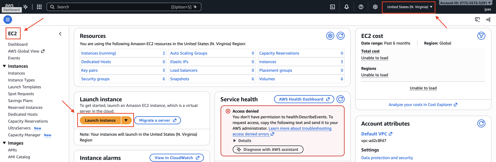

#### Configure your instance

1. **Name and tags:** Give your instance a recognizable name, such as `Firstname_Lastname`.
2. **Application and OS Images (Amazon Machine Image):** Under **My AMIs**, search for and select `cshl-seqtec-2026`.

   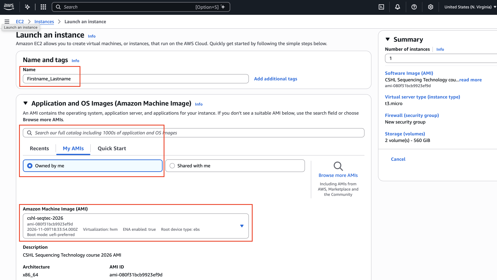

3. **Instance type:** Select `m6a.xlarge`.
4. **Key pair (login):** Select the course key pair, such as `cshl_2026_student`, or create a new key pair and save the downloaded key file somewhere you can find it. You will need the matching private key file to log in.
5. **Network settings:** Select the existing security group **SSH/HTTP/Jupyter/Rstudio - with outbound rule**, or create one with SSH and HTTP access.

   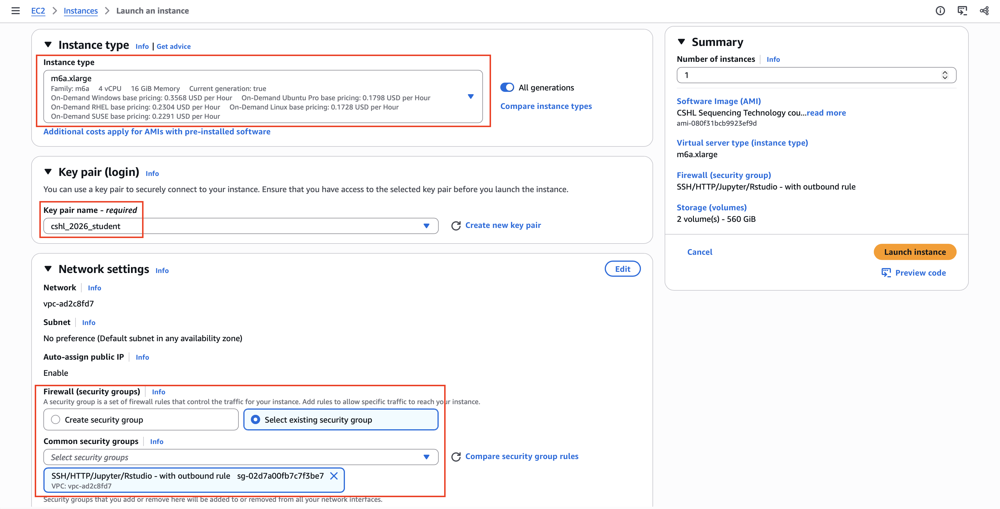

6. **Configure storage:** Confirm that two volumes are listed.

   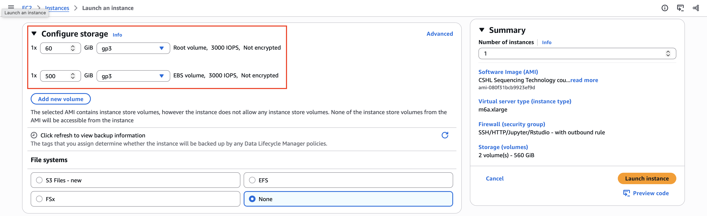

7. **Advanced details:** Enable **Termination protection**.

   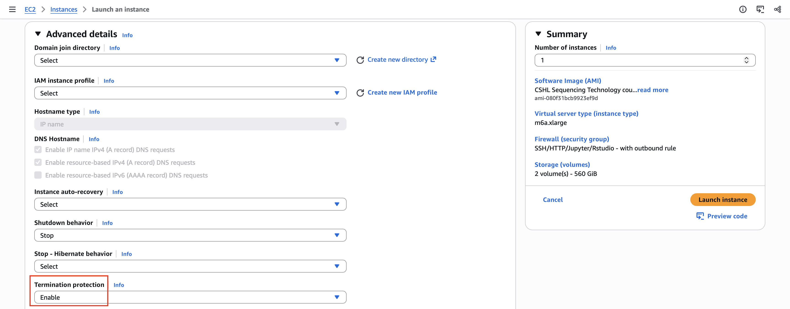

#### Launch and find your public IP address

1. Review the **Summary**, then select **Launch instance**.
2. Select **View all instances** and wait for your instance to finish initializing.
3. Select your instance, then choose **Connect**. On the **EC2 Instance Connect** tab, find and copy your **Public IP address**.

   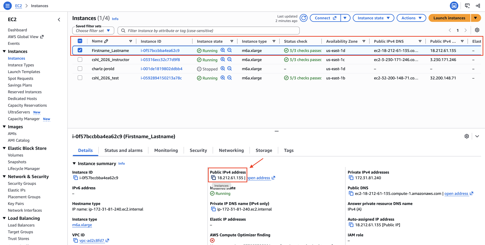

4. Follow the instructions below to log in from your computer.

### Logging in to your own AWS EC2 instance

Before you connect, have the following ready:

- **Your private key file:** For Terminal or PowerShell, use `cshl_2026_student.pem` (or the key file matching the key pair you selected when launching your instance).
- **Your instance's public IP address or public DNS name:** Copy this from the EC2 console.
- **The instance user name:** `ubuntu`. This is the Linux user on the instance, separate from your AWS console user name.

> **Connect only to your own instance.** If two students use the same instance, they may overwrite each other's files or interfere with each other's work.

Choose the instructions for your computer:

- [Mac/Linux](#maclinux)
- [Windows](#windows)

#### Mac/Linux

1. Open a terminal. On a Mac, go to **Applications → Utilities → Terminal**.
2. Restrict access to your private key file:

   ```bash
   chmod 400 "/path/to/cshl_2026_student.pem"
   ```

3. Connect to your instance using SSH:

   ```bash
   ssh -i "/path/to/cshl_2026_student.pem" ubuntu@YOUR_PUBLIC_IP
   ```

Replace `/path/to/cshl_2026_student.pem` in **both commands** with the actual path to your downloaded key file. Replace `YOUR_PUBLIC_IP` with your instance's public IP address or public DNS name.

For example, if your key is in the Downloads folder on a Mac:

```bash
chmod 400 "$HOME/Downloads/cshl_2026_student.pem"
ssh -i "$HOME/Downloads/cshl_2026_student.pem" ubuntu@YOUR_PUBLIC_IP
```

Here, `-i` specifies the private key file, `ubuntu` is the user on the instance, and the value after `@` identifies the instance to connect to.

#### Windows

Choose one of the following tools to connect to your instance:

- [PowerShell](#powershell)
- [PuTTY](#putty)

##### PowerShell

Open **PowerShell** and connect using the downloaded `.pem` key file:

```powershell
ssh -i "C:\path\to\cshl_2026_student.pem" ubuntu@YOUR_PUBLIC_IP
```

Replace `C:\path\to\cshl_2026_student.pem` with the actual path to your key file and `YOUR_PUBLIC_IP` with your instance's public IP address or public DNS name. The `chmod` step above applies to Mac/Linux only.

If PowerShell does not recognize `ssh`, install the [Windows OpenSSH Client](https://learn.microsoft.com/en-us/windows-server/administration/openssh/openssh_install_firstuse) or use PuTTY as described below.

##### PuTTY

To configure PuTTy, start PuTTy and do the following:
* Fill in the “Host name” field with your ip address.

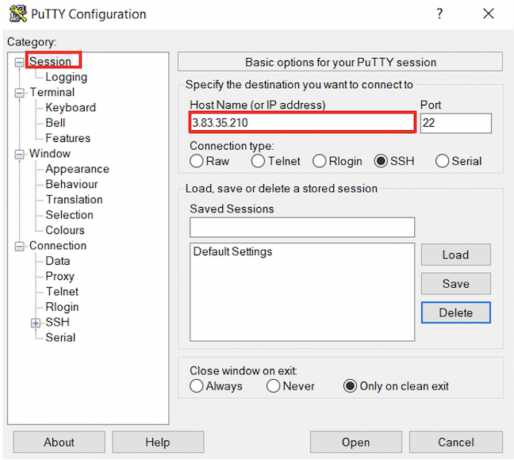

* In the left hand categories,under the Connection category choose Data. In the auto-login username field write `ubuntu`.

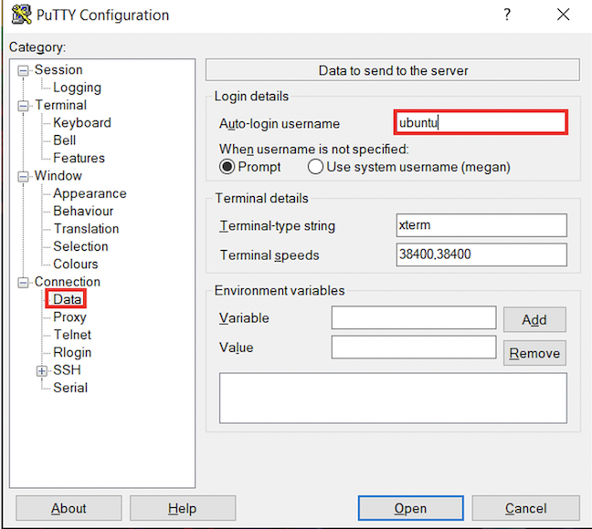

* In the left hand categories, in the Connection category next to SSH click on the +. Click on Auth. In the private-key file for authentication field, hit browse and find the `cshl_2026_student.ppk` certificate that you downloaded above.

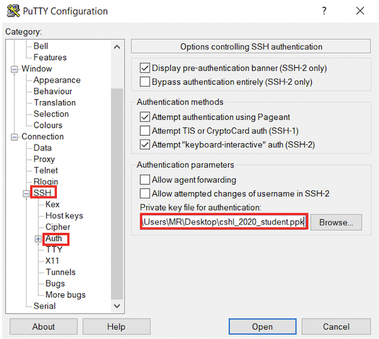

* In the left hand categories, click on Session. In the Saved Sessions field write Amazon node and click save.

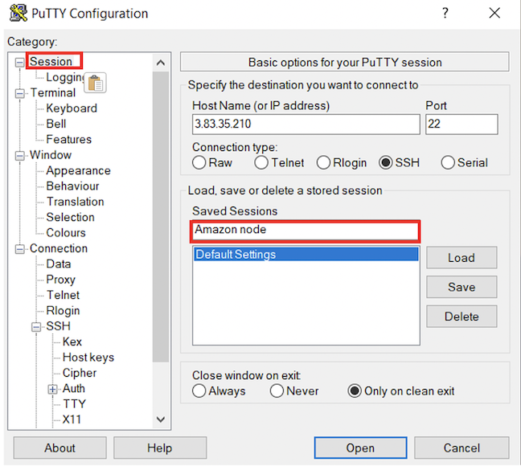

* Now that Putty is configured, all you have to do is start putty and double-click on “Amazon node” to login.

### File system layout on AWS instance

When you log in, you will notice that you have one  directory already: "workspace".

* The "workspace" directory is where we will keep all files and analysis results for this course.

### Transferring files between your computer and AWS

Choose the direction you want to transfer files:

- [Download files from the instance](#download-files-from-the-instance) to your computer.
- [Upload files to the instance](#upload-files-to-the-instance) from your computer.

#### Download files from the instance

* To copy files from an instance, use scp in a similar fashion (in this case to copy a file called nice_alignments.bam):

```bash
scp -i cshl_2026_student.pem ubuntu@[your ip address or dns name]:nice_alignments.bam .
```

* Everything created in your workspace on the cloud is also available by a web server on your cloud instance.  Simply go to the following in your browser:

http://[your ip address]/ or https://[your dns name]

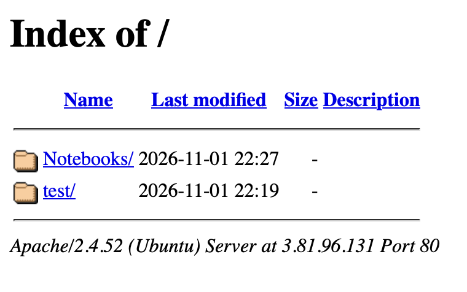


#### Upload files to the instance

If you would like to upload your data to the AWS instance, use the example scp command below.  Be sure to replace the variables below with the local path to your data, __MY_DATA__, and the amazon instance IP, __YOUR_IP_ADDRESS__.

```bash
scp -i cshl_2026_student.pem __MY_DATA__ ubuntu@[your ip address or dns name]:/
```

### Doing this course with AWS outside of a workshop
If you are trying to do this course on your own using the online materials only, of course an AWS EC2 instance has not been set up for you. If you have access to an AWS account though you can can start with the same Amazon AMI we use to create instances for each student. Currently this is:

Name: `cshl-seqtec-2026` available in the US East, N. Virginia region (us-east-1).

We typically use an instance type of `m6a.xlarge`. For detailed instructions on how we created the AMI and configure each instance, please refer to the [AWS Setup](https://rnabio.org/module-09-appendix/0009/09/01/AWS_Setup/) page.

### Basic introduction to your AWS EC2 instance

Once you are logged into your EC2 instance using `ssh`, the following commands can be used to explore basic information about the machine
```bash

#How are storage volumes mounted?
lsblk

#How much storage space in being used for various mount points?
df -h

#Detailed description of hardware
lshw

#See active resource usage right now with "top".  Use "1" to see all CPUs individually.  Use "q" to exit
top

```

## Using Docker

We have built a docker image with all necessary software tools installed to complete this course. This allows the hands-on exercises to be perfomed on your own desktop or laptop or anywhere that has docker installed. The following commands can be used to download and run this image as an interactive docker container. 

First you will need to install docker. Typically this involves installing [Docker Desktop](https://docs.docker.com/get-docker/). Once installed, start docker, and open a terminal application. Explanations of how to do this are detailed above in the [Using AWS](#using-aws) section.  At the terminal you can test your docker installation is working/running with `docker --help`. Once you have docker working you can use the following commands to download, set up, and run the rnabio image.

1. Pull the image to your local Docker client from the griffithlab repository:
```bash
docker pull griffithlab/rnaseq-toolkit:latest
```
2. Setup a local workspace directory for the RNAseq course. If you change the path or command used here in Step 2, make sure to update the path to the workspace directory accordingly in Step 3.
```bash
mkdir -p /tmp/rnabio-workspace
```
3. Initialize a Docker container using the image we pulled above. -v tells Docker to mount our workspace directory within the Docker container as /workspace. You'll see in the RNAseq course /workspace is the base directory for nearly all commands and steps. Note: we are running this docker container interactively, opening port 8080, and entering it at a bash shell prompt.
```bash
docker run -it -p 127.0.0.1:8080:8080 -v /tmp/rnabio-workspace:/workspace griffithlab/rnaseq-toolkit:latest
```

Optionally, to enable Docker functionality within the container (for running other bioinformatics containers):
```bash
# Mount the Docker socket to enable host Docker engine access
docker run -it -p 127.0.0.1:8080:8080 -v /tmp/rnabio-workspace:/workspace -v /var/run/docker.sock:/var/run/docker.sock griffithlab/rnaseq-toolkit:latest
```

The docker session should now be ready for the Unix tutorial and practical exercises.
